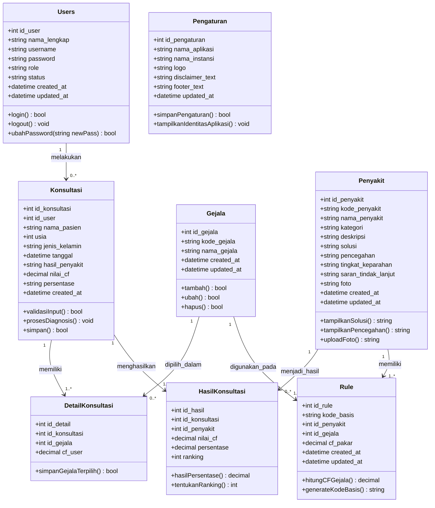

# Basis Pengetahuan Lengkap Sistem Pakar Diagnosa Penyakit Kulit (15 Penyakit & 68 Gejala)

Dokumen ini disusun sebagai pengembangan basis pengetahuan (*knowledge base*) sistem pakar yang mengacu pada penelitian:
> **Judul Acuan:** Sistem Pakar Diagnosa Penyakit Kulit Menggunakan Metode Forward Chaining dan Certainty Factor  
> **Jurnal:** Jurnal Riset dan Aplikasi Mahasiswa Informatika (JRAMI), Vol 07 No 04 Tahun 2026, Hal. 804–813  
> **Penulis:** Hera Syakira, Mercy Hermawati, Nurul Frijuniarsi  
> **Metode Inferensi:** *Forward Chaining* (Pelacakan Aturan IF-THEN) & *Certainty Factor* (Tingkat Keyakinan)

Dokumen ini memuat **15 Penyakit Kulit** (10 penyakit dari jurnal + 5 penyakit baru) dan **68 Gejala Fix (G01–G68)**, dilengkapi dengan **Tabel Basis Aturan Forward Chaining**, **Bobot CF Pakar**, **Matriks Keputusan**, serta **Script SQL MySQL**.

---

## 1. Daftar 15 Penyakit Kulit (P01 – P15)

| Kode | Nama Penyakit | Kategori Penularan | Etiologi & Karakteristik |
| :---: | :--- | :--- | :--- |
| **P01** | Dermatitis Atopik / Eksim | **Tidak Menular** | Peradangan kulit kronis, alergi, dan faktor keturunan |
| **P02** | Tinea / Kurap | **Menular** | Infeksi jamur dermatofita pada kulit |
| **P03** | Dermatitis Seboroik | **Tidak Menular** | Peradangan pada kulit berminyak, bersisik dan berketombe |
| **P04** | Prurigo | **Tidak Menular** | Bintil gatal kronis yang timbul akibat siklus garukan |
| **P05** | Impetigo Krustosa | **Menular** | Infeksi bakteri piogenik dengan kerak kuning seperti madu |
| **P06** | Herpes Zoster | **Menular** | Reaktivasi virus cacar air pada satu area saraf dermatom |
| **P07** | Urtikaria / Biduran | **Tidak Menular** | Reaksi alergi berupa bentol merah yang hilang timbul |
| **P08** | Skabies / Kudis | **Menular** | Infestasi parasit tungau *Sarcoptes scabiei* (menular kelompok) |
| **P09** | Psoriasis | **Tidak Menular** | Gangguan autoimun dengan sisik tebal berlapis mika |
| **P10** | Varisela / Cacar Air | **Menular** | Infeksi primer virus cacar air menyebar ke seluruh tubuh |
| **P11** | Acne Vulgaris (Jerawat) | **Tidak Menular** | Penyumbatan & peradangan folikel pilosebasea oleh sebum |
| **P12** | Vitiligo (Bercak Putih) | **Tidak Menular** | Hilangnya pigmen melanin kulit akibat proses autoimun |
| **P13** | Cellulitis (Selulitis) | **Menular (Bakteri)** | Infeksi bakteri akut menyebar pada dermis dan subkutan |
| **P14** | Bisul (Furunkel) | **Menular (Bakteri)** | Infeksi bakteri *Staphylococcus* pada folikel rambut |
| **P15** | Keloid | **Tidak Menular** | Pertumbuhan berlebih jaringan parut fibrosa melampaui luka |

---

## 2. Daftar 68 Gejala Penyakit Kulit Fix (G01 – G68)

| Kode | Deskripsi Gejala | Sumber / Korelasi |
| :---: | :--- | :--- |
| **G01** | Terasa gatal | Jurnal JRAMI |
| **G02** | Kulit tampak kering | Jurnal JRAMI |
| **G03** | Gatal bertambah saat berkeringat dan udara panas | Jurnal JRAMI |
| **G04** | Bercak kemerahan pada wajah, leher, lipatan tubuh, tangan, atau kaki | Jurnal JRAMI |
| **G05** | Memiliki riwayat alergi, seperti gatal, asma, atau bersin pada pagi hari | Jurnal JRAMI |
| **G06** | Memiliki riwayat alergi pada keluarga | Jurnal JRAMI |
| **G07** | Bercak kemerahan berbentuk cincin, berbatas tegas, dengan bagian tengah sesuai warna kulit atau keputihan | Jurnal JRAMI |
| **G08** | Kulit tampak bersisik halus | Jurnal JRAMI |
| **G09** | Memiliki pekerjaan yang sering terpapar air | Jurnal JRAMI |
| **G10** | Memiliki aktivitas yang sering menimbulkan keringat | Jurnal JRAMI |
| **G11** | Kulit kemerahan disertai sisik dan ketombe | Jurnal JRAMI |
| **G12** | Terdapat sisik berwarna kuning berminyak | Jurnal JRAMI |
| **G13** | Berbau tidak sedap | Jurnal JRAMI |
| **G14** | Keluhan terdapat pada kulit kepala, wajah terutama alis, dada bagian atas, atau lipatan tubuh | Jurnal JRAMI |
| **G15** | Gatal menetap hingga berbulan-bulan | Jurnal JRAMI |
| **G16** | Gatal mengganggu aktivitas sehari-hari | Jurnal JRAMI |
| **G17** | Bintik kemerahan hingga kehitaman, terkadang terdapat cairan putih atau kekuningan di atasnya | Jurnal JRAMI |
| **G18** | Kebiasaan terus menggaruk hingga menimbulkan darah dan luka | Jurnal JRAMI |
| **G19** | Bercak kerak kuning kecoklatan dan kental seperti madu, dapat disertai rasa perih | Jurnal JRAMI |
| **G20** | Bercak menyebar dalam waktu singkat saat disentuh atau digaruk | Jurnal JRAMI |
| **G21** | Sering terdapat di wajah, sekitar mulut dan lubang hidung, dan dapat menyebar lebih luas | Jurnal JRAMI |
| **G22** | Gatal semakin hebat seperti tersengat, panas, terbakar, atau tertusuk | Jurnal JRAMI |
| **G23** | Bintik kemerahan berisi cairan yang bergerombol pada satu sisi atau bagian tubuh tertentu | Jurnal JRAMI |
| **G24** | Memiliki riwayat varisela atau cacar air | Jurnal JRAMI |
| **G25** | Dapat disertai demam, lemas, nyeri sendi, nyeri kepala, serta rasa panas atau terbakar pada bintik | Jurnal JRAMI |
| **G26** | Bentol pucat hingga kemerahan yang terjadi singkat dan dapat hilang dalam beberapa jam atau hari | Jurnal JRAMI |
| **G27** | Kulit lebih sensitif terhadap sentuhan ringan | Jurnal JRAMI |
| **G28** | Gejala muncul kembali setelah sebelumnya sembuh atau kambuh | Jurnal JRAMI |
| **G29** | Bintik kemerahan hingga kehitaman dengan cairan putih atau kekuningan dan gatal memberat pada malam hari | Jurnal JRAMI |
| **G30** | Sulit tidur karena gatal | Jurnal JRAMI |
| **G31** | Keluhan mengenai satu kelompok, seperti keluarga serumah, pondok pesantren, panti asuhan, atau pengungsian | Jurnal JRAMI |
| **G32** | Keluhan terdapat pada lipatan ketiak, payudara, perut, paha, sela jari, bokong, atau kemaluan | Jurnal JRAMI |
| **G33** | Gatal hilang timbul dan dapat disertai rasa panas | Jurnal JRAMI |
| **G34** | Gambaran kemerahan berbentuk bulat atau oval | Jurnal JRAMI |
| **G35** | Sisik tebal dan transparan seperti lapisan mika | Jurnal JRAMI |
| **G36** | Terdapat riwayat keluarga dengan keluhan atau penyakit yang sama | Jurnal JRAMI |
| **G37** | Bintik kemerahan berisi cairan yang dapat menyebar hampir ke seluruh tubuh | Jurnal JRAMI |
| **G38** | Dapat disertai demam, lemas, nyeri sendi, dan nyeri kepala | Jurnal JRAMI |
| **G39** | Dalam beberapa jam berubah menjadi lepuhan berisi cairan | Jurnal JRAMI |
| **G40** | Lepuhan dapat pecah dan menjadi luka | Jurnal JRAMI |
| **G41** | Lepuhan mengering dan membentuk keropeng | Jurnal JRAMI |
| **G42** | Biasanya sembuh dalam 1 sampai 2 minggu | Jurnal JRAMI |
| **G43** | Terdapat komedo terbuka (blackhead) | Penyakit Baru (Acne) |
| **G44** | Terdapat komedo tertutup (whitehead) | Penyakit Baru (Acne) |
| **G45** | Muncul benjolan kecil kemerahan (papula) | Penyakit Baru (Acne) |
| **G46** | Muncul bintil berisi nanah (pustula) | Penyakit Baru (Acne) |
| **G47** | Terdapat benjolan besar dan nyeri (nodul) | Penyakit Baru (Acne) |
| **G48** | Keluhan kulit muncul di wajah, dada, atau punggung | Penyakit Baru (Acne) |
| **G49** | Kulit tampak berminyak | Penyakit Baru (Acne) |
| **G50** | Muncul bercak putih seperti susu | Penyakit Baru (Vitiligo) |
| **G51** | Warna kulit pada bercak kehilangan pigmen | Penyakit Baru (Vitiligo) |
| **G52** | Batas bercak putih terlihat jelas | Penyakit Baru (Vitiligo) |
| **G53** | Bercak putih muncul pada beberapa bagian tubuh | Penyakit Baru (Vitiligo) |
| **G54** | Bercak putih muncul di wajah, tangan, jari, ketiak, atau lipatan tubuh | Penyakit Baru (Vitiligo) |
| **G55** | Bercak putih umumnya tidak terasa gatal | Penyakit Baru (Vitiligo) |
| **G56** | Kulit mengalami kemerahan pada area tertentu | Penyakit Baru (Cellulitis/Bisul) |
| **G57** | Kulit terasa panas ketika disentuh | Penyakit Baru (Cellulitis/Bisul) |
| **G58** | Area kulit mengalami pembengkakan | Penyakit Baru (Cellulitis/Bisul) |
| **G59** | Area kulit yang terkena terasa nyeri | Penyakit Baru (Cellulitis) |
| **G60** | Mengalami menggigil atau tubuh terasa tidak enak | Penyakit Baru (Cellulitis) |
| **G61** | Muncul benjolan merah yang keras dan semakin membesar | Penyakit Baru (Bisul) |
| **G62** | Benjolan berisi nanah putih atau kekuningan | Penyakit Baru (Bisul) |
| **G63** | Benjolan dapat pecah dan mengeluarkan cairan | Penyakit Baru (Bisul) |
| **G64** | Benjolan terasa nyeri atau berdenyut, terutama saat disentuh | Penyakit Baru (Bisul) |
| **G65** | Muncul jaringan parut yang menonjol dan keras | Penyakit Baru (Keloid) |
| **G66** | Jaringan parut tumbuh melebihi batas luka awal dan tidak mengecil sendiri | Penyakit Baru (Keloid) |
| **G67** | Jaringan parut muncul setelah luka, jerawat, tindik, atau operasi | Penyakit Baru (Keloid) |
| **G68** | Area jaringan parut terasa gatal | Penyakit Baru (Keloid) |

---

## 3. Basis Aturan Forward Chaining (Tabel Aturan Produksi)

Tabel di bawah ini merupakan basis aturan lengkap (Rule 1 s/d Rule 27) yang memadukan 17 aturan resmi dari jurnal (Rule 1–17) dengan 10 aturan untuk 5 penyakit baru (Rule 18–27) yang terdiri dari **aturan utama** dan **aturan alternatif**.

| No. | Aturan Produksi (*IF - THEN*) | Hasil Penyakit | Keterangan Aturan |
| :---: | :--- | :--- | :--- |
| **1** | IF G01 AND G02 AND G03 AND G04 AND G05 AND G06 THEN P01 | Dermatitis Atopik / Eksim | Aturan Utama P01 (Jurnal) |
| **2** | IF G01 AND G02 AND G03 AND G07 AND G08 AND G09 AND G10 THEN P02 | Tinea / Kurap | Aturan Utama P02 (Jurnal) |
| **3** | IF G01 AND G02 AND G11 AND G12 AND G13 AND G14 THEN P03 | Dermatitis Seboroik | Aturan Utama P03 (Jurnal) |
| **4** | IF G01 AND G15 AND G16 AND G17 AND G18 THEN P04 | Prurigo | Aturan Utama P04 (Jurnal) |
| **5** | IF G01 AND G19 AND G20 AND G21 THEN P05 | Impetigo Krustosa | Aturan Utama P05 (Jurnal) |
| **6** | IF G01 AND G22 AND G23 AND G24 AND G25 THEN P06 | Herpes Zoster | Aturan Utama P06 (Jurnal) |
| **7** | IF G01 AND G22 AND G26 AND G27 AND G28 THEN P07 | Urtikaria / Biduran | Aturan Utama P07 (Jurnal) |
| **8** | IF G01 AND G29 AND G30 AND G31 AND G32 THEN P08 | Skabies / Kudis | Aturan Utama P08 (Jurnal) |
| **9** | IF G01 AND G33 AND G34 AND G35 AND G36 THEN P09 | Psoriasis | Aturan Utama P09 (Jurnal) |
| **10** | IF G01 AND G37 AND G38 AND G39 AND G40 AND G41 AND G42 THEN P10 | Varisela / Cacar Air | Aturan Utama P10 (Jurnal) |
| **11** | IF G37 AND G38 AND G39 AND G40 AND G41 AND G42 THEN P10 | Varisela / Cacar Air | Aturan Alternatif P10 (Jurnal) |
| **12** | IF G01 AND G02 AND G04 AND G05 AND G06 THEN P01 | Dermatitis Atopik / Eksim | Aturan Alternatif P01 (Jurnal) |
| **13** | IF G01 AND G07 AND G08 AND G09 AND G10 THEN P02 | Tinea / Kurap | Aturan Alternatif P02 (Jurnal) |
| **14** | IF G01 AND G11 AND G12 AND G14 THEN P03 | Dermatitis Seboroik | Aturan Alternatif P03 (Jurnal) |
| **15** | IF G15 AND G16 AND G17 AND G18 THEN P04 | Prurigo | Aturan Alternatif P04 (Jurnal) |
| **16** | IF G19 AND G20 AND G21 THEN P05 | Impetigo Krustosa | Aturan Alternatif P05 (Jurnal) |
| **17** | IF G22 AND G23 AND G24 AND G25 THEN P06 | Herpes Zoster | Aturan Alternatif P06 (Jurnal) |
| **18** | IF G43 AND G44 AND G45 AND G46 AND G48 AND G49 THEN P11 | Acne Vulgaris (Jerawat) | **Aturan Utama P11** |
| **19** | IF G43 AND G45 AND G47 AND G48 AND G49 THEN P11 | Acne Vulgaris (Jerawat) | **Aturan Alternatif P11 (Nodul/Kistik)** |
| **20** | IF G50 AND G51 AND G52 AND G53 AND G54 AND G55 THEN P12 | Vitiligo (Bercak Putih) | **Aturan Utama P12** |
| **21** | IF G50 AND G51 AND G52 AND G54 THEN P12 | Vitiligo (Bercak Putih) | **Aturan Alternatif P12** |
| **22** | IF G56 AND G57 AND G58 AND G59 AND G60 THEN P13 | Cellulitis (Selulitis) | **Aturan Utama P13** |
| **23** | IF G38 AND G56 AND G57 AND G58 AND G59 THEN P13 | Cellulitis (Selulitis) | **Aturan Alternatif P13** |
| **24** | IF G56 AND G57 AND G58 AND G61 AND G62 AND G63 AND G64 THEN P14 | Bisul (Furunkel) | **Aturan Utama P14** |
| **25** | IF G61 AND G62 AND G63 AND G64 THEN P14 | Bisul (Furunkel) | **Aturan Alternatif P14** |
| **26** | IF G65 AND G66 AND G67 AND G68 THEN P15 | Keloid | **Aturan Utama P15** |
| **27** | IF G01 AND G65 AND G66 AND G67 THEN P15 | Keloid | **Aturan Alternatif P15** |

---

## 4. Nilai Bobot Pakar (*Certainty Factor*) Penyakit Baru

Skala bobot pakar yang digunakan sesuai jurnal:
* `0.2` : Sangat Lemah
* `0.4` : Lemah
* `0.6` : Cukup Kuat
* `0.8` : Kuat
* `1.0` : Sangat Kuat / Patognomonis

### P11. Acne Vulgaris (Jerawat)
* `G43` (Komedo terbuka): **1.0** *(Patognomonis jerawat)*
* `G44` (Komedo tertutup): **1.0** *(Patognomonis jerawat)*
* `G45` (Papula merah): **0.8**
* `G46` (Pustula nanah): **0.8**
* `G47` (Nodul besar nyeri): **0.8**
* `G48` (Lokasi wajah, dada, punggung): **0.8**
* `G49` (Kulit berminyak): **0.8**

### P12. Vitiligo (Bercak Putih)
* `G50` (Bercak putih seperti susu): **1.0** *(Patognomonis depigmentasi)*
* `G51` (Warna bercak kehilangan pigmen): **1.0**
* `G52` (Batas bercak terlihat jelas): **0.8**
* `G53` (Muncul pada beberapa bagian tubuh): **0.8**
* `G54` (Lokasi wajah, tangan, jari, ketiak): **0.8**
* `G55` (Umumnya tidak terasa gatal): **0.6**

### P13. Cellulitis (Selulitis)
* `G56` (Kemerahan area tertentu): **0.8**
* `G57` (Kulit terasa panas saat disentuh): **0.8**
* `G58` (Area kulit bengkak / edema): **1.0** *(Tanda kardinal selulitis)*
* `G59` (Area terkena terasa nyeri): **0.8**
* `G60` (Menggigil / tubuh tidak enak): **0.8**
* `G38` (Demam sistemik, lemas, nyeri sendi): **0.8**

### P14. Bisul (Furunkel)
* `G56` (Kemerahan pada area tertentu): **0.6**
* `G57` (Kulit terasa panas saat disentuh): **0.6**
* `G58` (Area kulit bengkak): **0.8**
* `G61` (Benjolan merah keras membesar): **1.0** *(Morfologi khas furunkel)*
* `G62` (Benjolan berisi nanah putih/kuning): **1.0**
* `G63` (Pecah mengeluarkan cairan): **0.8**
* `G64` (Nyeri atau berdenyut saat disentuh): **0.8**

### P15. Keloid
* `G01` (Terasa gatal): **0.6**
* `G65` (Jaringan parut menonjol dan keras): **1.0**
* `G66` (Tumbuh melampaui luka awal & tak mengecil): **1.0** *(Tanda pembeda mutlak keloid)*
* `G67` (Muncul setelah luka, jerawat, operasi): **0.8**
* `G68` (Area jaringan parut terasa gatal): **0.8**

---

## 5. Matriks Hubungan 68 Gejala dan 15 Penyakit (Tabel Keputusan)

| Kode | Gejala Singkat | P01 | P02 | P03 | P04 | P05 | P06 | P07 | P08 | P09 | P10 | P11 | P12 | P13 | P14 | P15 |
| :---: | :--- | :---: | :---: | :---: | :---: | :---: | :---: | :---: | :---: | :---: | :---: | :---: | :---: | :---: | :---: | :---: |
| **G01** | Terasa gatal | ✓ | ✓ | ✓ | ✓ | ✓ | ✓ | ✓ | ✓ | ✓ | ✓ | | | | | ✓ |
| **G02** | Kulit tampak kering | ✓ | ✓ | ✓ | | | | | | | | | | | | |
| **G03** | Gatal bertambah saat berkeringat | ✓ | ✓ | | | | | | | | | | | | | |
| **G04** | Kemerahan wajah, leher, lipatan | ✓ | | | | | | | | | | | | | | |
| **G05** | Riwayat alergi pribadi | ✓ | | | | | | | | | | | | | | |
| **G06** | Riwayat alergi keluarga | ✓ | | | | | | | | | | | | | | |
| **G07** | Bercak cincin tepi aktif | | ✓ | | | | | | | | | | | | | |
| **G08** | Bersisik halus | | ✓ | | | | | | | | | | | | | |
| **G09** | Terpapar air | | ✓ | | | | | | | | | | | | | |
| **G10** | Aktivitas berkeringat | | ✓ | | | | | | | | | | | | | |
| **G11** | Kemerahan & ketombe | | | ✓ | | | | | | | | | | | | |
| **G12** | Sisik kuning berminyak | | | ✓ | | | | | | | | | | | | |
| **G13** | Bau tidak sedap | | | ✓ | | | | | | | | | | | | |
| **G14** | Kulit kepala, alis, dada | | | ✓ | | | | | | | | | | | | |
| **G15** | Gatal berbulan-bulan | | | | ✓ | | | | | | | | | | | |
| **G16** | Ganggu aktivitas | | | | ✓ | | | | | | | | | | | |
| **G17** | Bintik merah kehitaman / cairan | | | | ✓ | | | | | | | | | | | |
| **G18** | Menggaruk hingga berdarah | | | | ✓ | | | | | | | | | | | |
| **G19** | Kerak kuning madu | | | | | ✓ | | | | | | | | | | |
| **G20** | Menyebar cepat disentuh | | | | | ✓ | | | | | | | | | | |
| **G21** | Sekitar mulut & hidung | | | | | ✓ | | | | | | | | | | |
| **G22** | Rasa tersengat/terbakar | | | | | | ✓ | ✓ | | | | | | | | |
| **G23** | Bintik berair berkelompok | | | | | | ✓ | | | | | | | | | |
| **G24** | Riwayat cacar air | | | | | | ✓ | | | | | | | | | |
| **G25** | Demam, lemas, nyeri sendi | | | | | | ✓ | | | | | | | | | |
| **G26** | Bentol hilang timbul | | | | | | | ✓ | | | | | | | | |
| **G27** | Lebih sensitif sentuhan | | | | | | | ✓ | | | | | | | | |
| **G28** | Kambuhan / hilang timbul | | | | | | | ✓ | | | | | | | | |
| **G29** | Gatal berat malam hari | | | | | | | | ✓ | | | | | | | |
| **G30** | Sulit tidur karena gatal | | | | | | | | ✓ | | | | | | | |
| **G31** | Mengenai satu kelompok | | | | | | | | ✓ | | | | | | | |
| **G32** | Lipatan ketiak, paha, sela jari| | | | | | | | ✓ | | | | | | | |
| **G33** | Gatal hilang timbul panas | | | | | | | | | ✓ | | | | | | |
| **G34** | Bercak bulat atau oval | | | | | | | | | ✓ | | | | | | |
| **G35** | Sisik tebal lapisan mika | | | | | | | | | ✓ | | | | | | |
| **G36** | Riwayat keluarga sama | | | | | | | | | ✓ | | | | | | |
| **G37** | Bintik sebar seluruh tubuh | | | | | | | | | | ✓ | | | | | |
| **G38** | Demam sistemik cacar/selulitis | | | | | | | | | | ✓ | | | ✓ | | |
| **G39** | Berubah jadi lepuhan | | | | | | | | | | ✓ | | | | | |
| **G40** | Lepuhan pecah jadi luka | | | | | | | | | | ✓ | | | | | |
| **G41** | Mengering jadi keropeng | | | | | | | | | | ✓ | | | | | |
| **G42** | Sembuh 1-2 minggu | | | | | | | | | | ✓ | | | | | |
| **G43** | Komedo terbuka (blackhead) | | | | | | | | | | | ✓ | | | | |
| **G44** | Komedo tertutup (whitehead) | | | | | | | | | | | ✓ | | | | |
| **G45** | Benjolan kecil papula | | | | | | | | | | | ✓ | | | | |
| **G46** | Bintil nanah pustula | | | | | | | | | | | ✓ | | | | |
| **G47** | Benjolan nodul besar nyeri | | | | | | | | | | | ✓ | | | | |
| **G48** | Lokasi wajah, dada, punggung | | | | | | | | | | | ✓ | | | | |
| **G49** | Kulit tampak berminyak | | | | | | | | | | | ✓ | | | | |
| **G50** | Bercak putih seperti susu | | | | | | | | | | | | ✓ | | | |
| **G51** | Kehilangan pigmen kulit | | | | | | | | | | | | ✓ | | | |
| **G52** | Batas bercak terlihat jelas | | | | | | | | | | | | ✓ | | | |
| **G53** | Bercak di beberapa bagian | | | | | | | | | | | | ✓ | | | |
| **G54** | Lokasi wajah, tangan, ketiak | | | | | | | | | | | | ✓ | | | |
| **G55** | Bercak tidak terasa gatal | | | | | | | | | | | | ✓ | | | |
| **G56** | Kemerahan pada area tertentu | | | | | | | | | | | | | ✓ | ✓ | |
| **G57** | Kulit terasa panas disentuh | | | | | | | | | | | | | ✓ | ✓ | |
| **G58** | Pembengkakan area kulit | | | | | | | | | | | | | ✓ | ✓ | |
| **G59** | Area terkena terasa nyeri | | | | | | | | | | | | | ✓ | | |
| **G60** | Menggigil / tidak enak badan | | | | | | | | | | | | | ✓ | | |
| **G61** | Benjolan merah keras membesar | | | | | | | | | | | | | | ✓ | |
| **G62** | Benjolan bernanah putih/kuning| | | | | | | | | | | | | | ✓ | |
| **G63** | Benjolan pecah keluar cairan | | | | | | | | | | | | | | ✓ | |
| **G64** | Nyeri berdenyut saat disentuh | | | | | | | | | | | | | | ✓ | |
| **G65** | Parut menonjol dan keras | | | | | | | | | | | | | | | ✓ |
| **G66** | Parut lebihi batas luka awal | | | | | | | | | | | | | | | ✓ |
| **G67** | Parut paska luka/jerawat/operasi| | | | | | | | | | | | | | | ✓ |
| **G68** | Area parut terasa gatal | | | | | | | | | | | | | | | ✓ |

---

## 6. Script SQL Insert Siap Pakai (Database MySQL)

```sql
-- 1. Insert Data 5 Penyakit Baru ke Tabel `penyakit`
INSERT INTO `penyakit` (`kode_penyakit`, `nama_penyakit`, `deskripsi`, `solusi`, `pencegahan`, `tingkat_keparahan`) VALUES
('P11', 'Acne Vulgaris (Jerawat)', 'Peradangan kronis folikel pilosebasea yang ditandai dengan timbulnya komedo, papula, pustula, dan nodul.', 'Gunakan pembersih wajah asam salisilat atau benzoil peroksida, serta retinoid topikal sesuai petunjuk dokter.', 'Bersihkan wajah secara rutin, hindari memencet jerawat, dan gunakan produk berlabel non-comedogenic.', 'Ringan'),
('P12', 'Vitiligo (Bercak Putih)', 'Kelainan kulit jangka panjang di mana melanosit kehilangan pigmen sehingga muncul bercak putih seperti susu.', 'Terapi topikal kortikosteroid atau inhibitor kalsineurin, serta fototerapi (UVB) di bawah pengawasan dokter spesialis kulit.', 'Gunakan tabir surya berspektrum luas untuk melindungi area bercak dari luka bakar sinar matahari.', 'Sedang'),
('P13', 'Cellulitis (Selulitis)', 'Infeksi bakteri akut pada dermis dan subkutan yang menyebabkan kemerahan luas, bengkak, hangat, dan nyeri hebat.', 'Pemberian antibiotik oral atau infus secepatnya oleh dokter, serta meninggikan posisi area tubuh yang terinfeksi.', 'Rawat dan bersihkan luka terbuka sekecil apa pun dengan antiseptik dan jaga kebersihan kulit.', 'Berat'),
('P14', 'Bisul (Furunkel / Karbunkel)', 'Infeksi bakteri Staphylococcus aureus yang menyebabkan benjolan bernanah dan meradang di sekitar folikel rambut.', 'Kompres hangat 3-4 kali sehari untuk mempermudah drainase nanah. Jangan memencet bisul secara paksa.', 'Jaga kebersihan tubuh dengan mandi teratur menggunakan sabun dan jangan berbagi handuk/pakaian.', 'Sedang'),
('P15', 'Keloid', 'Pertumbuhan berlebih jaringan parut fibrosa padat yang menonjol dan meluas melampaui batas luka asli.', 'Suntikan kortikosteroid intralesi, terapi lembaran gel silikon, krioterapi, atau terapi laser.', 'Hindari luka yang tidak perlu seperti tindik atau tato bila memiliki riwayat keloid.', 'Ringan');

-- 2. Insert 26 Gejala Baru (G43 - G68) ke Tabel `gejala`
INSERT INTO `gejala` (`kode_gejala`, `nama_gejala`) VALUES
('G43', 'Terdapat komedo terbuka (blackhead)'),
('G44', 'Terdapat komedo tertutup (whitehead)'),
('G45', 'Muncul benjolan kecil kemerahan (papula)'),
('G46', 'Muncul bintil berisi nanah (pustula)'),
('G47', 'Terdapat benjolan besar dan nyeri (nodul)'),
('G48', 'Keluhan kulit muncul di wajah, dada, atau punggung'),
('G49', 'Kulit tampak berminyak'),
('G50', 'Muncul bercak putih seperti susu'),
('G51', 'Warna kulit pada bercak kehilangan pigmen'),
('G52', 'Batas bercak putih terlihat jelas'),
('G53', 'Bercak putih muncul pada beberapa bagian tubuh'),
('G54', 'Bercak putih muncul di wajah, tangan, jari, ketiak, atau lipatan tubuh'),
('G55', 'Bercak putih umumnya tidak terasa gatal'),
('G56', 'Kulit mengalami kemerahan pada area tertentu'),
('G57', 'Kulit terasa panas ketika disentuh'),
('G58', 'Area kulit mengalami pembengkakan'),
('G59', 'Area kulit yang terkena terasa nyeri'),
('G60', 'Mengalami menggigil atau tubuh terasa tidak enak'),
('G61', 'Muncul benjolan merah yang keras dan semakin membesar'),
('G62', 'Benjolan berisi nanah putih atau kekuningan'),
('G63', 'Benjolan dapat pecah dan mengeluarkan cairan'),
('G64', 'Benjolan terasa nyeri atau berdenyut, terutama saat disentuh'),
('G65', 'Muncul jaringan parut yang menonjol dan keras'),
('G66', 'Jaringan parut tumbuh melebihi batas luka awal dan tidak mengecil sendiri'),
('G67', 'Jaringan parut muncul setelah luka, jerawat, tindik, atau operasi'),
('G68', 'Area jaringan parut terasa gatal');
```

---

## 7. Class Diagram Sistem Pakar (UML)

Sesuai dengan pemodelan perangkat lunak pada **Gambar 4 (halaman 809 jurnal acuan)**, sistem pakar diagnosa penyakit kulit terdiri dari **8 kelas utama** yang saling berelasi:



### Penjelasan Relasi Antarkelas:
1. **`Users` ke `Konsultasi` (1 ke 0..\*):** Satu akun pengguna/pasien dapat melakukan nol atau banyak kali sesi konsultasi.
2. **`Konsultasi` ke `DetailKonsultasi` (1 ke 1..\*):** Setiap satu sesi konsultasi memiliki satu atau lebih gejala yang dipilih beserta bobot keyakinan pengguna (`cf_user`).
3. **`Gejala` ke `DetailKonsultasi` (1 ke 0..\*):** Satu gejala dapat dipilih di dalam nol atau banyak sesi detail konsultasi.
4. **`Konsultasi` ke `HasilKonsultasi` (1 ke 1..\*):** Setiap sesi konsultasi menghasilkan ranking penyakit teratas beserta persentase keyakinannya.
5. **`Penyakit` ke `HasilKonsultasi` (1 ke 0..\*):** Satu penyakit dapat menjadi hasil diagnosis pada nol atau banyak riwayat konsultasi.
6. **`Penyakit` ke `Rule` (1 ke 1..\*):** Satu penyakit memiliki satu atau banyak relasi aturan basis pengetahuan.
7. **`Gejala` ke `Rule` (1 ke 1..\*):** Satu gejala digunakan pada satu atau banyak aturan inferensi dengan bobot pakar (`cf_pakar`) masing-masing.
8. **`Pengaturan` (Singleton):** Berdiri sendiri untuk menyimpan konfigurasi sistem, identitas klinik, logo, dan disclaimer.

